=======================
 Excel演習 その3
=======================

グラフの描写
^^^^^^^^^^^^^^^^^^^^^^^^^^^^^^^^^^^^^^^^^^^^

| 今回はExcelのグラフ機能について解説をします。Excelでは、レポートや発表資料などを作る際に便利なグラフを簡単に作れます。棒グラフ、円グラフなどデザインも幾つかの種類用意されています。
| 作成したグラフはWordやPowerPointなどに貼り付けることで、データを掲載するために使用することも出来ます。Excelでデータをまとめてグラフを作成し、レポートや発表などに活用するのも良いでしょう。

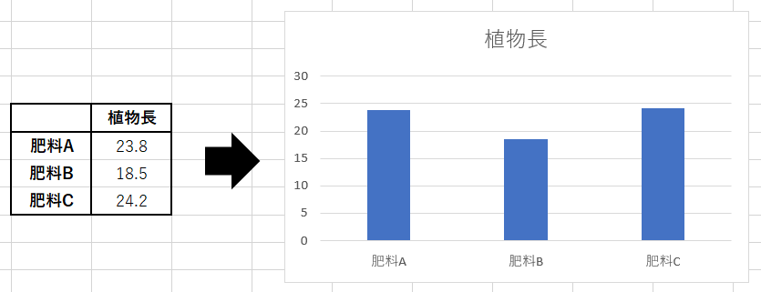

基本的なグラフの作成方法
------------------------------------------------

| それでは実際にグラフを作る方法について解説していきます。
| Excelではセルに入力された値をそのままグラフにできます。
| 今回は `[こちらの練習ファイル] <_static/documents/excel/practice6.xlsx>`_ を利用して、実際に操作しながら色々なグラフを作成してみましょう。

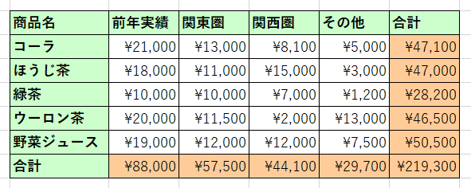

| グラフは以下の手順で簡単に作成できます。
| グラフに必要な範囲を選択します。とりあえず「前年実績」をグラフ化してみましょう。
| このとき「前年実績」でまとまっている一連の値のことを、Excelでは「データ系列」あるいは単に「系列」と呼びます。
| 範囲を選択したら、「挿入」タブ →「グラフ」グループにある「縦棒」のボタンなどをクリックすると、グラフが自動的に作成されます。

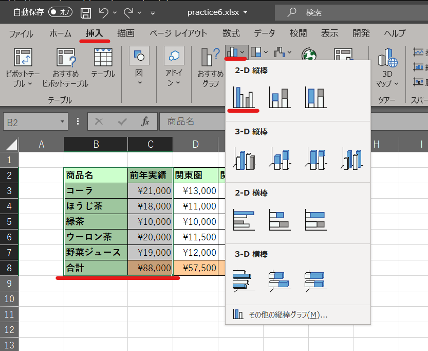

.. note::
    | 「見出し」部分も一緒に選択しておくと、グラフ内にラベルが自動入力されるので便利です。
    | 見出しとして認識できる範囲は、データの上と左にある１行・１列分が基本です。

| 範囲選択を工夫すれば、データが離れた場所にある場合でもグラフ化できます。
| たとえば、「関東圏」と「関西圏」のデータを並べてグラフ化したいなら、以下のように範囲選択しましょう。
| 複数の範囲選択の方法は以前もやりましたが、一箇所目をドラッグで選択した後、Ctrlキー(MacはCommandキー)を押しながら二箇所目を追加選択します。

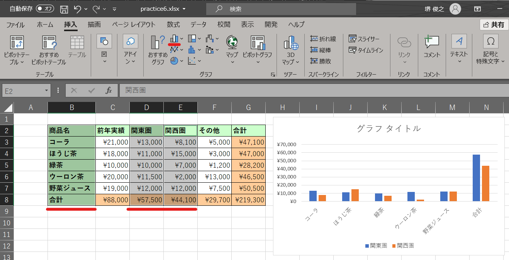

データソースの選択
------------------------------------------------

| Excelの自動選択では、思い通りのラベル選択やx/y軸のデータが選択されないこともあります。
| そんな場合は「データの選択」から、選択したいデータやラベルの編集を行います。
| 作成したグラフをクリックし、「グラフのデザイン」タブ→「データの選択」ボタンをクリックするか、グラフを右クリックして「データの選択」を選択します。

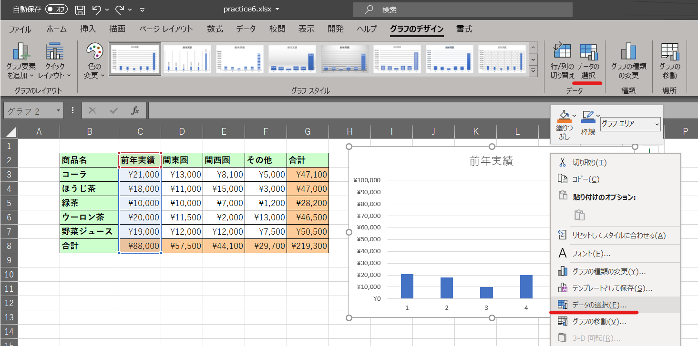

| 複数の系列を含むグラフの場合は、左の「系列1」等と書いてある部分で、編集したい系列を選択します。
| 右の「編集」ボタンをクリックすることで、ラベルを編集することが出来ます。ラベルにしたい文字が入力してあるセルの範囲を選択しても良いですし、自分で直接「XXX, YYY, ZZZ」の様にカンマ区切りで打ち込んでも大丈夫です。

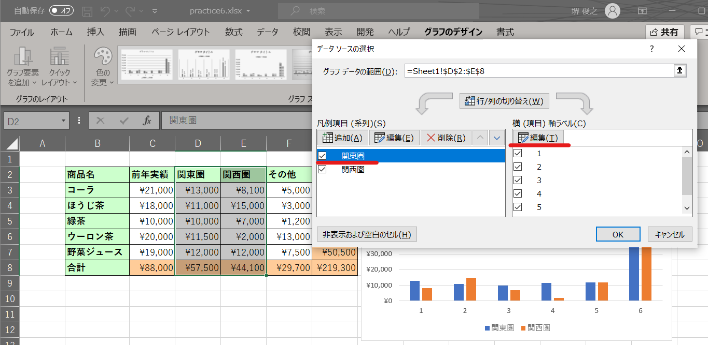

| 表示したいデータを選択し直すには、「グラフデータの範囲」を変更したり、左の項目を追加・編集することで、表示させたいデータの選択を行うことが出来ます。

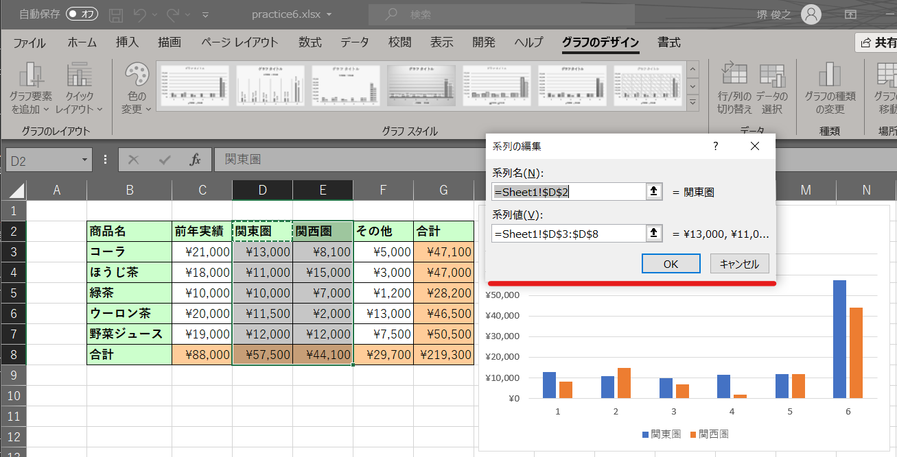

グラフの種類
------------------------------------------------
| グラフには様々な種類があります。「挿入」メニューには、様々なグラフを作るためのボタンが並んでいますので、適切なグラフを選んで作成してください。状況にあわせて見やすいグラフの種類を選びましょう。

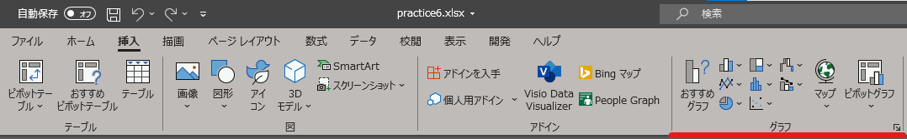

棒グラフ

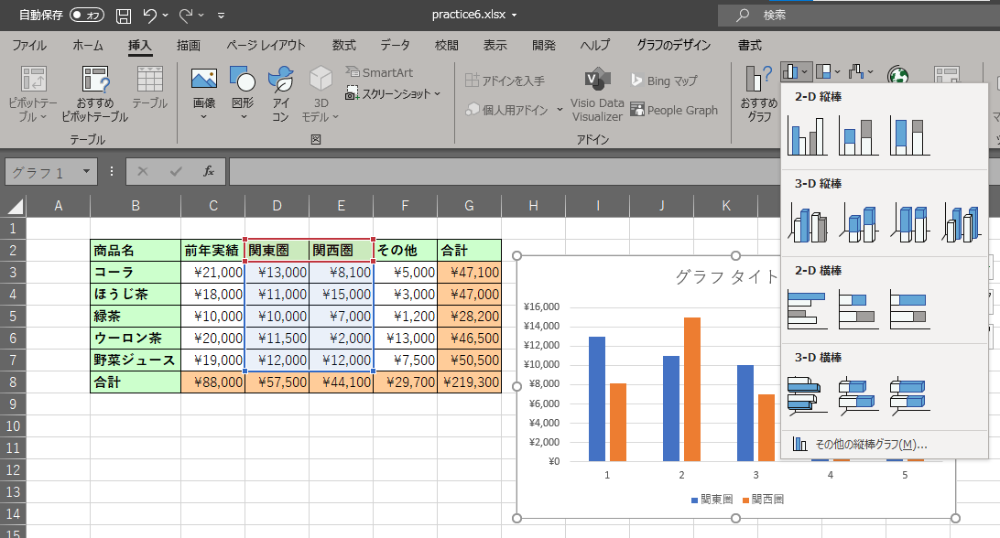

折れ線グラフ

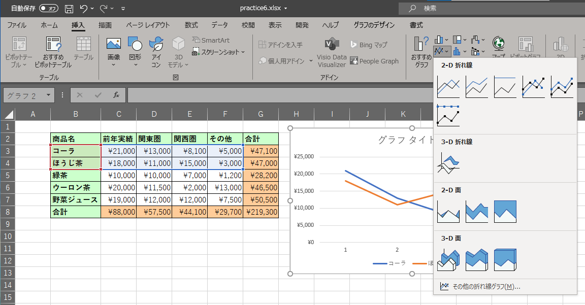

円グラフ

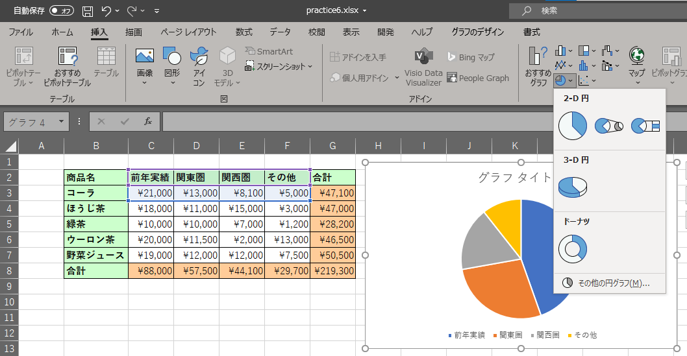

.. note::
    | 円グラフは良く見かけるグラフではありますが、データを表現する方法としては分かりにくい表現方法の一つになります。可能な限り使用は避けた方が良いでしょう。

散布図と折れ線グラフの使い分け
------------------------------------------------
| 折れ線グラフと散布図(直線とマーカー)は見た目が似ていますが、横軸の扱いが大きく異なります。
| 折れ線グラフの横軸は「項目軸」で、横軸の値を単なるラベルとして扱い、 **値の大小に関係なく等間隔に並べます** 。
| 一方、散布図の横軸は「数値軸」で、値の大きさに応じた位置にデータが置かれます。
| そのため、測定の間隔が不均等なデータを折れ線グラフにすると、グラフの形が歪んでしまいます。

| 例えば、次のような生育調査のデータを考えてみましょう。

.. list-table::
   :header-rows: 1
   :widths: 20 20

   * - 播種後日数(日)
     - 草丈(cm)
   * - 0
     - 0.0
   * - 3
     - 1.2
   * - 7
     - 3.5
   * - 14
     - 8.4
   * - 28
     - 19.8
   * - 56
     - 42.1

**練習**

| `[こちらの練習ファイル6_2] <_static/documents/excel/practice6_2.xlsx>`_ を開いて、以下を試してみましょう。
| 同じデータから折れ線グラフと散布図(直線とマーカー)を作成し、形を比べてみましょう。

| このデータを折れ線グラフにすると、「0→3日」の区間も「28→56日」の区間も同じ幅で描かれるため、後半になって急激に伸びたように(指数関数的に増えているように)見えてしまいます。
| 散布図(直線とマーカー)で描くと、実際には序盤以降ほぼ一定の速さで伸びていることが分かります。

| 横軸が「月」や「年」、「処理区A, B, C」の様に等間隔の項目であれば折れ線グラフ(や棒グラフ)で問題ありません。
| 横軸が「日数」「濃度」「温度」の様な数値で、その間隔に意味がある場合は散布図を使いましょう。

.. note::
    | 横軸に日付を入力している場合、Excelが自動的に「日付軸」として間隔を反映してくれることもあります。
    | ただし、日付が文字列として入力されている場合は項目軸として扱われるので、描いたグラフの横軸の間隔は必ず確認しましょう。

.. note::
    | 後で扱う近似曲線にも注意が必要です。
    | 折れ線グラフに近似曲線を追加すると、Excelは横軸の値ではなく、1, 2, 3, ...というデータの順番をxとして計算します。
    | そのため、表示される近似式は実際のデータとは無関係なものになってしまいます。近似曲線や回帰分析を行う場合は、必ず散布図を使いましょう。

グラフの編集
------------------------------------------------
| 作成したグラフは、レイアウトやデザインを編集することができます。
| グラフをクリックすると、「グラフのデザイン」と「書式」という新しいタブが現れます(Officeのバージョンによっては「グラフツール」等の場合もあります)。このタブからグラフの細かい編集ができます。

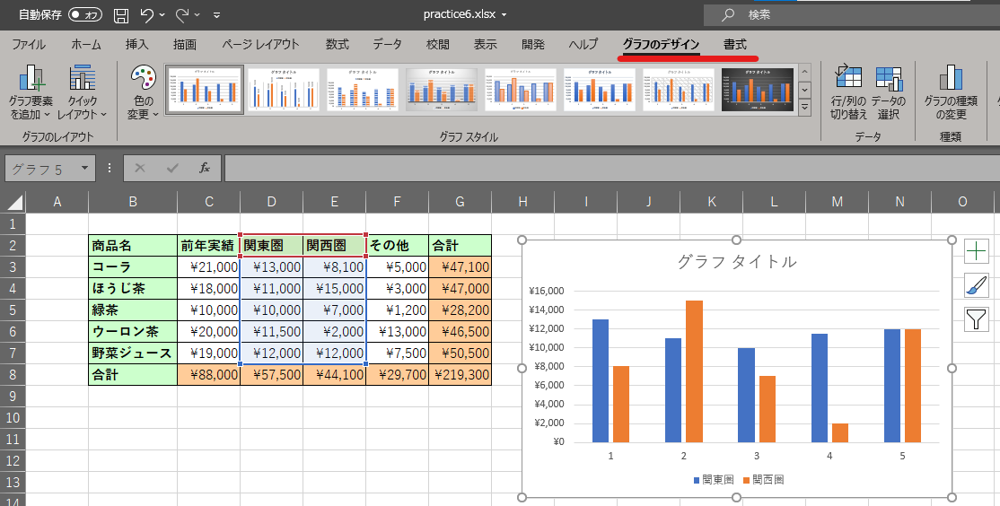

| グラフのデザインの「グラフ要素を追加」から、軸のラベルや凡例など、グラフに様々な要素を追加できます。グラフが分かりやすくなるように適宜追加してください。追加した要素はそれぞれ、マウスでドラッグすることで位置を調整できます。
| 追加出来る要素は以下の様なものになります。

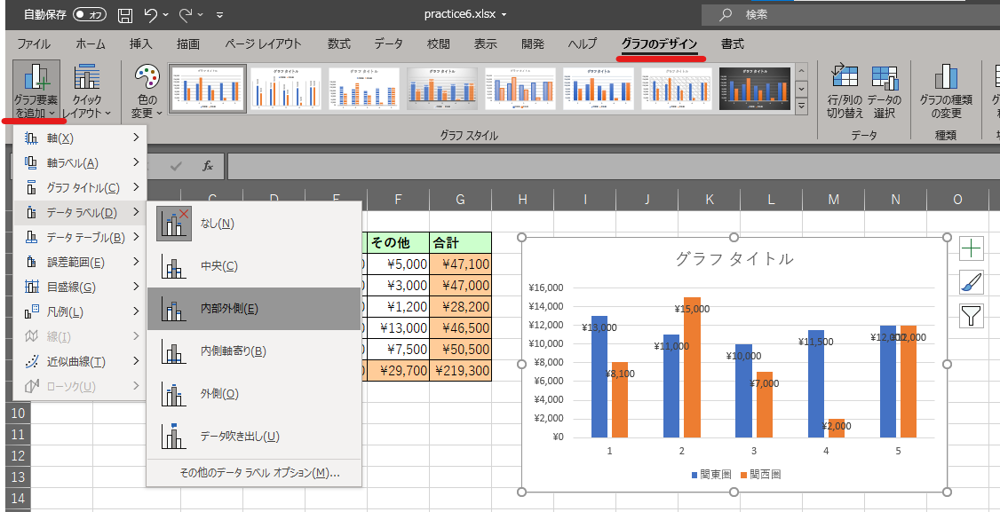

==================================== ==================================================== 
 要素                                 調整対象                                             
==================================== ==================================================== 
グラフエリア                          背景部分、グラフ全体のサイズや背景色。
------------------------------------ ----------------------------------------------------
プロットエリア                        グラフ描写部分。グラフ自体の大きさ。        
------------------------------------ ----------------------------------------------------
グラフタイトル                        グラフの表題。  
------------------------------------ ----------------------------------------------------
軸ラベル                              縦軸と横軸に対する説明。
------------------------------------ ----------------------------------------------------
データラベル                          各項目の正確な値。
------------------------------------ ----------------------------------------------------
凡例                                  どの色のグラフが何の項目を示すかの対応表      
------------------------------------ ----------------------------------------------------
目盛線                                縦横の罫線。  
==================================== ====================================================

| 「書式」タブでは、グラフエリア内にある各パーツをクリックし、色を塗ったり枠線を描いたりフォントを変えることができます。
| また、より細かい調整をしたい場合、調整したい要素を右クリックして、「XXの書式設定」を選びましょう。

| 右端近くにある「グラフの種類変更」で、一旦作成したグラフを別の種類に変更できます（折れ線グラフ→円グラフなど）。

第２軸の利用
------------------------------------------------

| スケールの異なる２系統のデータがある時に、縦軸をもう一つ追加したい場合があります。たとえば以下のような状況です。

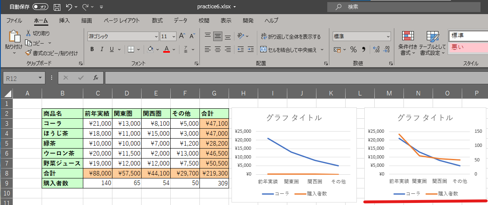

| この様に、スケールの異なるもう一つの軸を第2軸と呼び、以下の方法で追加することが出来ます。
| 第２軸に移動させたいデータ系列を選択し、右クリックから書式設定パネルを開きます。書式設定パネルの「系列のオプション」欄の「使用する軸」項目で「第２軸」を選択します。

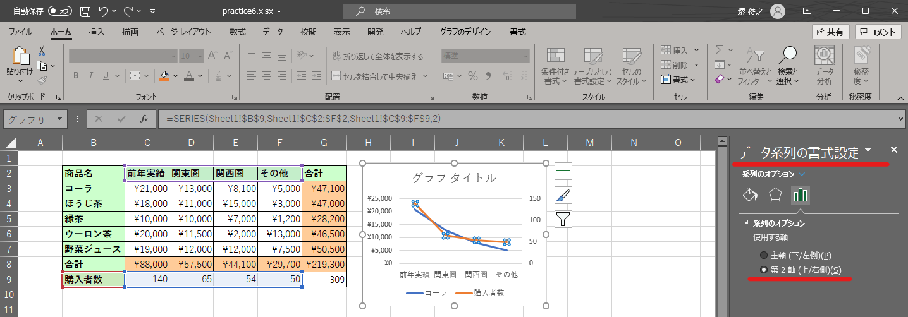

軸の最大・最小値を設定する
------------------------------------------------
| 値の変動が小さい場合、そのままグラフ化しただけでは違いが見えにくいことがあります。
| この様な場合は、縦軸の範囲を調整し、違いを見やすくすることが可能です。
| グラフの縦軸の数値を右クリックし、軸の書式設定を選択します。「軸のオプション」欄には「最小値」「最大値」を入力する欄があるので、そこで適切な値を設定します。
| ただし、軸の表示範囲を変えて、差を強調することは、恣意的な印象操作につながることもあるので注意して活用しましょう。

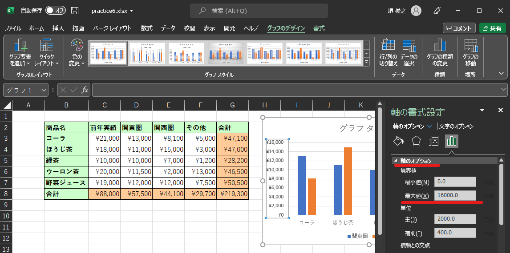

Wordでグラフを利用する
------------------------------------------------
| 通常Excelで作成した表やグラフは、Wordなど他のアプリケーションに貼り付け、レポートなどの資料の一つとして活用することが多いです。貼り付ける方法は簡単で、グラフを右クリックやCtrl+C(Mac:Command+C)で「コピー」して右クリックやCtrl+V(Mac:Command+V)で「貼り付け」すれば利用できます。
| 貼り付けの際にはいくつかの方法があります。

Microsoft Excelグラフ オブジェクト
そのまま直接貼り付けるとこの貼り付け方になります。Word上でグラフの再編集ができる貼り付け方ですが、Word上で少し色やレイアウトが変化してしまう場合もあるようです。

図(拡張メタファイル, PNG, JPG)として貼り付け
Word上で再編集することは出来ませんが、Excel上で作成したデザインをそのまま貼り付けることが可能です。

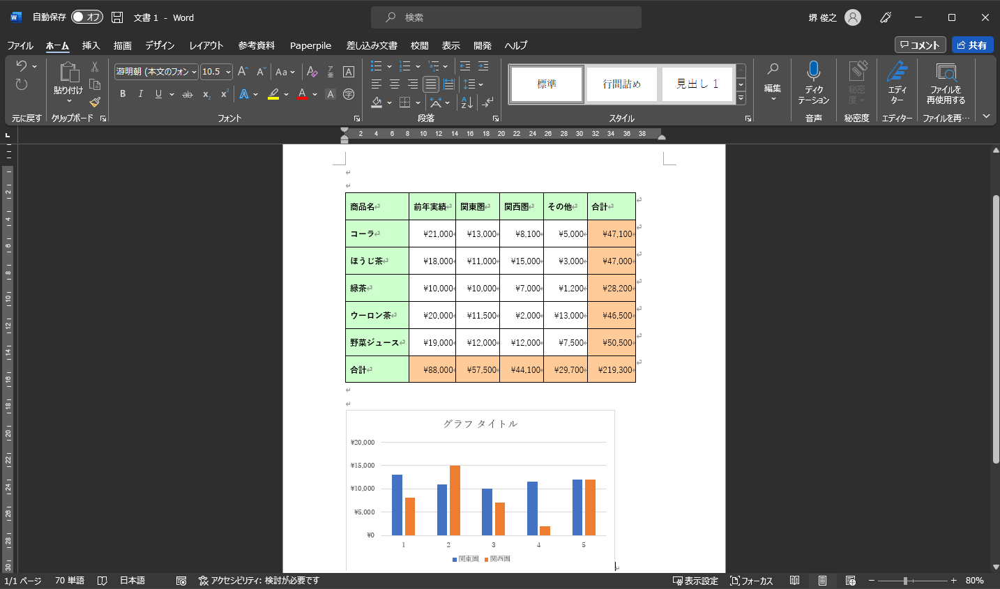

.. note::
    | Microsoft Excelグラフ オブジェクトとして貼り付けると、Wordでの処理が重くなる可能性があります。
    | 通常はPNGなどの画像として貼り付けるのが良いでしょう。

グラフ描写の練習問題
^^^^^^^^^^^^^^^^^^^^^^^^^^^^^^^^^^^^^^^^^^^^
| `[こちらの練習ファイル7] <_static/documents/excel/practice7.xlsx>`_ を開いて、グラフ描写の練習をしてみましょう。
| 練習ファイル7のデータを使って以下の様な図を作成してみて下さい。(大体同じに出来ればいいです。)

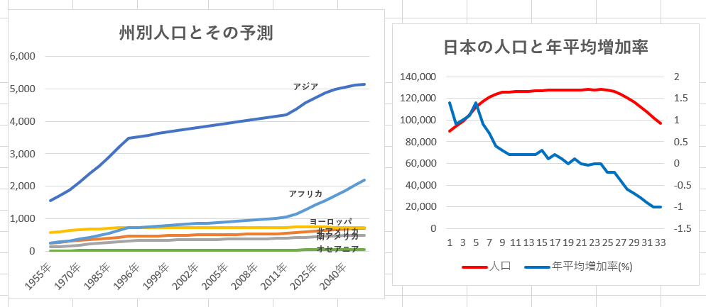

回帰分析などの簡単な分析
^^^^^^^^^^^^^^^^^^^^^^^^^^^^^^^^^^^^^^^^^^^^
| 散布図を描いた際に、回帰分析を行うことが良くあります。y = ax + b の様な形でx軸とy軸の相関を見る形です。
| 近似式だけを表示するのであれば、グラフ要素から近似直(曲)線を追加し、その書式設定から近似式を表示することが出来ます。

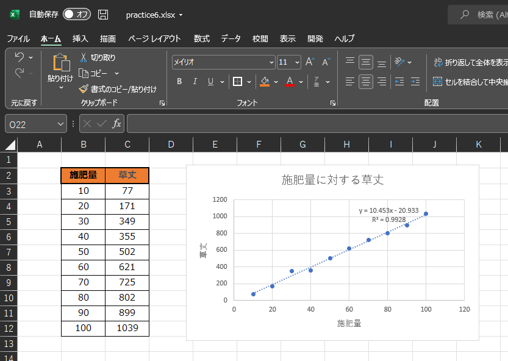

| 別のやり方として、Excelには分析ツールというものがあり、簡単な回帰分析や統計解析などを行うことが出来ます。
| 「データ」タブにありますが、初期状態のExcelでは無いかもしれません。その場合は「ファイル」→(「その他」→)「オプション」→「アドイン」からデータ分析を追加します。(Macの場合は画面上部のメニューからツール→Excelアドイン)
| アドインとはその名の通り、Excelへ新たな機能を追加する事を指します。

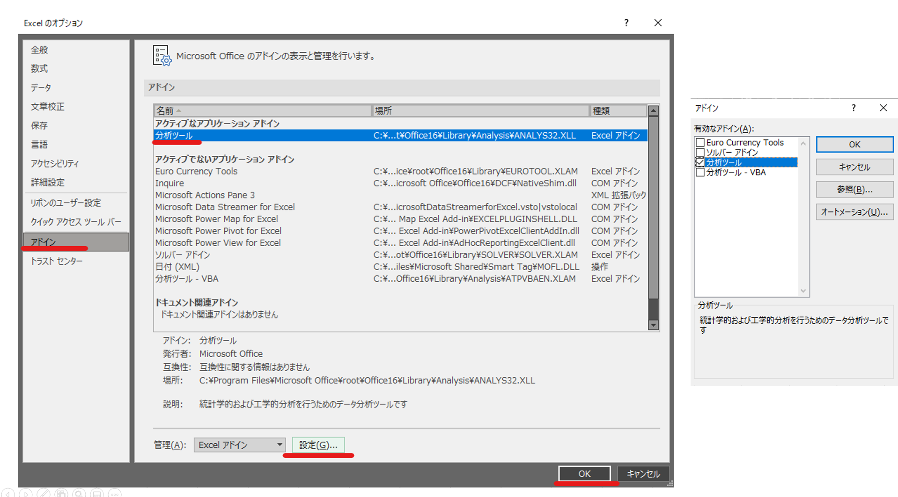

| データの範囲を選択して「ホーム」タブのデータ分析ボタンを押すと、Excelがいくつかのグラフを候補として色々と出してくれます。
| 今回は、「データ」タブのデータ分析ボタンから、回帰分析などの行いたい分析ボタンを選択します。そして分析対象のデータ範囲を入力することで、実際にExcelが分析をしてくれます。
| ここでは出力された結果の細かい解説は行いませんが(2回生の講義等で習うかと思います。)、他にも様々な分析を行うことが可能ですので、使ってみて下さい。

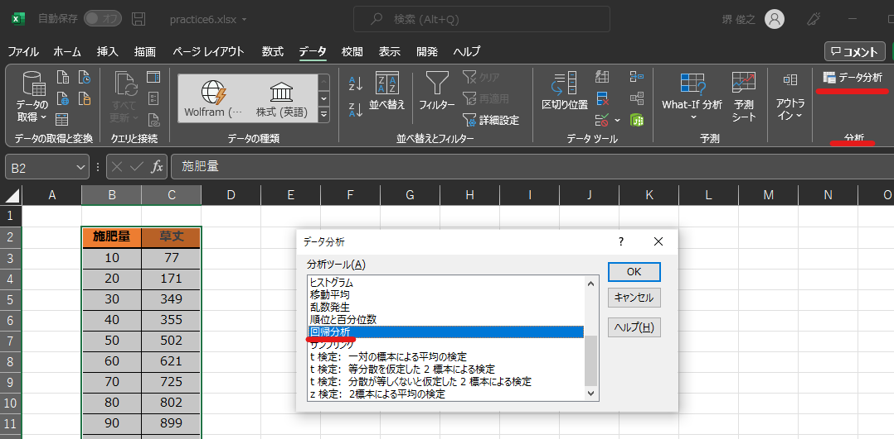

データ分析の練習問題
^^^^^^^^^^^^^^^^^^^^^^^^^^^^^^^^^^^^^^^^^^^^
| `[こちらの練習ファイル8] <_static/documents/excel/practice8.xlsx>`_ を開いて、データ分析の練習をしてみましょう。
| データ分析ツールだけでなく、これまでに学んだ知識を使ってもらっても構いません。

研究データの持ち方とExcelの落とし穴
^^^^^^^^^^^^^^^^^^^^^^^^^^^^^^^^^^^^^^^^^^^^
| 研究室に配属されると、実験や圃場調査のデータをExcelに入力し、それをRなどで解析することが多くなります。
| このとき、Excelにどの様な形でデータを入力しておくかで、後の解析の手間が大きく変わります。
| 「人間が見やすい表」と「コンピュータが扱いやすい表」は異なる、という点を意識しておきましょう。

整然データ(tidy data)の原則
------------------------------------------------
| 解析に使うデータは、以下の原則に従って入力しておくのが基本です。

- **1行に1つの観測、1列に1つの変数、1つのセルに1つの値** を入れる。
- 見出し(列名)は1行目だけにする。2段組みの見出しにしない。
- **セルの結合をしない。** 処理区名なども、全ての行に同じ値を入力する。
- **色や太字で情報を表さない。** 「測定ミス」などの情報は、「備考」や「除外」などの列を作って文字で記入する。
- 単位は列名に含める(例: 草丈_cm)。数値のセルには数値だけを入れ、単位や文字を混ぜない。
- 欠測値は空欄や「NA」などに統一し、0と区別する(0は「測った結果0だった」という意味になります)。
- 日付は「2025-05-10」の様な形式で統一する。
- 元の生データには手を加えず、計算やグラフは別のシートや別のファイルで行う。

| 例えば、以下の様な表はよく見かけますが、解析にはとても使いにくい形です。
| `[悪い例.xlsx] <_static/documents/excel/bad_table.xlsx>`_ 

.. table:: 【悪い例】

   +--------+--------------------------+--------------------------+
   |        | 対照区                   | 施肥区                   |
   |        +--------+--------+--------+--------+--------+--------+
   |        | 個体1  | 個体2  | 個体3  | 個体1  | 個体2  | 個体3  |
   +========+========+========+========+========+========+========+
   | 5/10   | 12.3   | 11.8   | 13.1   | 14.2   | 枯死   | 13.9   |
   +--------+--------+--------+--------+--------+--------+--------+
   | 5/17   | 15.0   | 14.1   | (黄色) | 17.5   | \-     | 16.8   |
   +--------+--------+--------+--------+--------+--------+--------+

| この表には、見出しが2段になっている、処理区名が結合セルになっている、数値の列に「枯死」や「-」などの文字が混ざっている、測定ミスを色で表している、年の情報がない、といった問題があります。
| 同じデータを整然データの形にすると、以下の様になります。
| `[良い例.xlsx] <_static/documents/excel/good_table.xlsx>`_ 

.. list-table:: 【良い例】
   :header-rows: 1

   * - date
     - treatment
     - plant_id
     - height_cm
     - note
   * - 2025-05-10
     - control
     - 1
     - 12.3
     -
   * - 2025-05-10
     - control
     - 2
     - 11.8
     -
   * - 2025-05-10
     - fertilizer
     - 2
     - NA
     - 枯死
   * - 2025-05-17
     - control
     - 3
     - NA
     - 測定ミス
   * - ...
     - ...
     - ...
     - ...
     - ...

| 縦に長く、人間にはやや見にくい表ですが、この形にしておけば、並べ替え・フィルター・ピボットテーブル、そしてRでの解析がそのまま行えます。

.. note::
    | 列名はRで扱いやすい様に、半角英数字とアンダースコア(_)で付けておくのがおすすめです。日本語やスペースを含む列名は、Rで扱う際に少し手間がかかります。
    | 参考: Broman, K. W. & Woo, K. H. (2018) Data Organization in Spreadsheets. *The American Statistician*, 72(1), 2-10.
    | 参考: Wickham, H. (2014) Tidy Data. *Journal of Statistical Software*, 59(10).

Excelの自動変換の罠
------------------------------------------------
| Excel演習その1で、「12/31」と入力すると自動的に日付に変換されることを紹介しました。
| この自動変換は便利な一方で、研究データを壊してしまう原因にもなります。代表的なものは以下の通りです。

.. list-table::
   :header-rows: 1
   :widths: 25 30 25

   * - 入力した値
     - Excelでの変換結果
     - 起こりやすい場面
   * - 1-2, 2/3
     - 1月2日, 2月3日 (日付)
     - 区画番号・反復番号
   * - 0012
     - 12 (先頭の0が消える)
     - 個体番号・系統番号
   * - (1)
     - -1 (負の数)
     - 番号付け
   * - 2310009E13
     - 2.31E+13 (指数表記の数値)
     - 遺伝子ID
   * - 15桁を超える数字
     - 16桁目以降が0になる
     - 長いサンプルID・バーコード

| 特に有名なのが遺伝子名の問題です。SEPT2やMARCH1といった遺伝子名が月名として解釈されて日付に変換されてしまう問題が、多くの論文の補足データで見つかりました。
| 2016年の調査(Ziemann et al., *Genome Biology*)では、Excelの遺伝子リストを補足データとして含む論文のおよそ5分の1に、この様な誤りが含まれていたと報告されています。
| 最終的に、2020年には遺伝子名の命名を管理する委員会(HGNC)が、SEPT2をSEPTIN2に、MARCH1をMARCHF1に、という様に遺伝子名そのものを変更する事態になりました。

| **一度変換された値は元に戻せない** ことが多い点にも注意が必要です。特に変換されたままCSVとして保存すると、元の値は完全に失われます。

**対策**

- 入力前に、該当する列のセルの表示形式を「文字列」にしておく(右クリック→セルの書式設定→表示形式)。
- 値の先頭に「'」(アポストロフィ)を付けて入力すると、文字列として扱われる。
- CSVファイルはダブルクリックで開かず、「データ」タブ→「テキストまたはCSVから」で読み込む。読み込み画面で「データ型検出」を「データ型を検出しない」にするか、列のデータ型を「テキスト」に指定する。
- 比較的新しいMicrosoft 365のExcelでは、「ファイル」→「オプション」→「データ」の「自動データ変換」から、一部の自動変換をオフにすることが出来ます。

CSVで保存する
------------------------------------------------
| Rなど他のソフトにデータを渡す場合は、CSV(Comma-Separated Values)形式で保存するのが一般的です。
| 「名前を付けて保存」で、ファイルの種類に **「CSV UTF-8(コンマ区切り)」** を選びましょう。
| 単なる「CSV(コンマ区切り)」を選ぶと、日本語版のWindowsではShift_JISという文字コードで保存され、Rで読み込んだ際に日本語が文字化けすることがあります。

.. note::
    | CSVに保存されるのは、選択中のシートのセルの「値」だけです。数式・色・罫線・グラフ・他のシートは保存されません。
    | 色で情報を表していると、CSVにした時点でその情報は消えてしまいます。この点からも、情報は必ず文字で記入しておきましょう。

シミュレーションの練習問題
^^^^^^^^^^^^^^^^^^^^^^^^^^^^^^^^^^^^^^^^^^^^
| Excelの数式を用いる事でシミュレーションの計算を行うことが出来ます。
| シミュレーション(simulation)とは考察の対象をモデルを用いて模擬することです。現実的にデータを収集することが難しい対象や、事前にシミュレーション結果を用いて実験の検討を行ったりするときに使用します。
| 今回は、補食-被食者モデル(ロトカ・ヴォルテラの方程式)をExcel上で実装してみます。
| 捕食―被食者モデルとは、時間の経過に応じて、捕食者の数と被食者の数がどの様な変遷をとるかをモデル化したものです。式で表すと

という風に表せます。被食者が増えると捕食者も増えていくが、捕食者が増えすぎると被食者の減りが激しくなり、被食者の数もそれに応じて減少していく…という様な関係性になります。

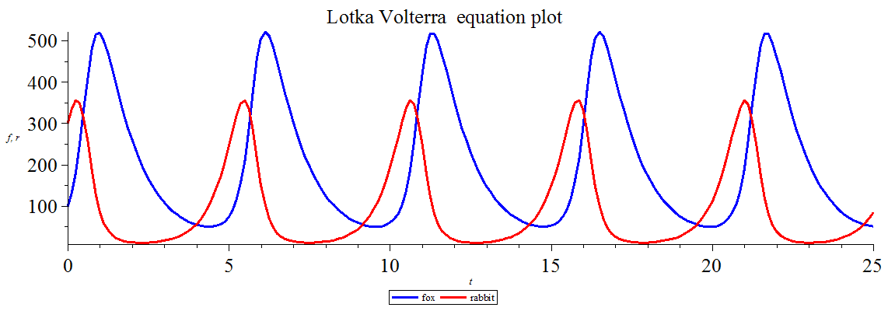

| `[こちらの練習ファイル9] <_static/documents/excel/practice9.xlsx>`_ を開いて、捕食-被食者関係のシミュレーションをつくってみましょう。
| また、シミュレーション結果をグラフ化して確認してみましょう。

画像は `[ロトカ・ヴォルテラの方程式] <https://ja.wikipedia.org/wiki/%E3%83%AD%E3%83%88%E3%82%AB%E3%83%BB%E3%83%B4%E3%82%A9%E3%83%AB%E3%83%86%E3%83%A9%E3%81%AE%E6%96%B9%E7%A8%8B%E5%BC%8F>`_ より引用。

.. note::
    | ロトカヴォルテラ方程式を解くには微分方程式を解く必要がありますが、今回はオイラー法を用いて解いています。
    | ExcelにはVBAと呼ばれるプログラミング言語の機能が実装されており、VBAを用いる事で別の解法で微分方程式を解くことも出来ます。
    | ただ、VBAでやるくらいならRやMathematicaでやった方が良いと思うので今回は割愛しています。

おまけ シミュレーションに「つまみ」を付ける
------------------------------------------------
| 作成したシミュレーションでは、パラメータ(増殖率や捕食率など)の値を書き換えると、計算結果とグラフが自動的に更新されます。
| ここに「スクロールバー」を付けると、つまみを動かすだけでパラメータを連続的に変えられるようになり、パラメータとグラフの形の関係を直感的に確かめることが出来ます。

.. note::
    | この仕組みが上手く動くためには、各時点の計算式がパラメータのセルを **絶対参照** で参照している必要があります。
    | パラメータを数式の中に直接書き込んでいる場合は、まずパラメータを専用のセルに移し、そのセルを絶対参照するように書き換えましょう。

**1. 開発タブを表示する**

| スクロールバーは「開発」タブから挿入しますが、初期状態では表示されていません。
| 「ファイル」→(「その他」→)「オプション」→「リボンのユーザー設定」を開き、右側の一覧の「開発」にチェックを入れます。
| (Macの場合は、画面上部のメニューから「Excel」→「環境設定」→「リボンとツールバー」で「開発」にチェックを入れます。)

**2. スクロールバーを挿入する**

| 「開発」タブ→「挿入」→「フォームコントロール」の中から「スクロールバー」を選び、シート上でドラッグして配置します。

.. スクロールバー挿入画面のスクリーンショットを追加予定

**3. スクロールバーとセルを結び付ける**

| 配置したスクロールバーを右クリックし、「コントロールの書式設定」→「コントロール」タブを開いて、以下を設定します。

.. list-table::
   :header-rows: 1
   :widths: 25 50

   * - 項目
     - 設定内容
   * - 最小値・最大値
     - つまみの値の範囲(0〜30000の整数)
   * - 変化の増分
     - 両端の矢印をクリックした時の変化量
   * - リンクするセル
     - つまみの値を書き込むセル(パラメータとは別の空いているセル)

| スクロールバーは **0以上の整数しか扱えない** ので、小数のパラメータを動かすには一工夫が必要です。
| 例えば、パラメータを0.00〜2.00の範囲で動かしたい場合は、最小値を0、最大値を200としてリンクするセル(例えばH2)に整数を書き込ませ、パラメータのセルには「=H2/100」という数式を入れます。

**4. つまみを動かしてみる**

| つまみを動かすと、パラメータの値が変わり、シミュレーション結果とグラフが連動して変化するはずです。
| 他のパラメータにも同様にスクロールバーを付けてみましょう。

.. note::
    | フォームコントロールはマクロではないので、通常の.xlsx形式のまま保存できます。
    | ただし、ブラウザ版のExcel(Excel for the web)ではスクロールバーを新たに挿入することは出来ないので、デスクトップ版のExcelを使って下さい。
    | 開発タブが使えない環境の場合は、パラメータのセルの値を直接書き換えても同じことを確かめられます。

| `[こちらの練習ファイル9_2] <_static/documents/excel/practice9_2.xlsx>`_ を参考に載せておきます。

**練習**

#. 被食者の増殖率を大きくしたり小さくしたりすると、個体数の振動の周期や振れ幅はどの様に変化するでしょうか。
#. 横軸を被食者の数、縦軸を捕食者の数とした散布図(直線のみ)を作成してみましょう。この様な図を「相平面」と呼び、理論上は同じ軌道を回り続ける閉じた輪になります。
#. 時間の刻み幅(Δt)もセルで指定してスクロールバーを付け、刻み幅を大きくしてみましょう。相平面の輪はどうなるでしょうか。

その他質問のあったこと
------------------------
| **Q. #N/Aというエラーが表示される原因を知りたいです。**
| A. 一般的に、NAエラーは返す値が無い時に現れます。MATCH関数やVLOOKUP関数で検索する際に、検索したい値が検索範囲に無いとNAとなってしまいます。
| 他の関数でもたまに起きますが、基本的には適用した関数の引数やデータにミスがある場合が多いです。

| **Q. 日数計算がうまくいかなかった。**
| A. セル同士で引き算をしても上手くいかない場合はDATEDIF関数を使うと良いかもしれません。
| =DATEDIF(開始日,終了日,"d")　みたいな感じです。練習問題2だと=DATEDIF($G$13,G6,"d")という感じでしょうか。

| **Q. IF関数の入れ子状態は複雑化した時の可読性が著しく低いので解消したい。何か便利な関数があるのだろうか。**
| A. 入れ子を回避する方法としてANDとかOR関数というものがあります。練習問題の3-2で扱います。

| **Q. 自分が思っている計算と違う計算をされたときにどうやって直せばよいのかわからない。**
| A. 基本的にエクセルが間違えることは無いので、何か入力を間違えている可能性が高いです。
| どこが間違えているかに気付くには経験を積むか詳しい人に聞くしか無いですね…。

| **Q. 相対参照を絶対参照にする判断基準ありますか、バグった値が出たら分かるけど、ミスに気づかない可能性がある、と感じました。**
| A. 確かにその可能性はあり得ます。計算式をコピーした後に、そのセルを選択すると、
| どの場所のセルを使用して計算を行っているかが分かるので、それで正しいセルを使用した計算式になっているかを確認すると良いと思います。

| **Q. 文字色を変えても反映されないことがある。**
| A. 確実な原因は分からないですが、セルの表示形式が設定されている可能性や条件付き書式が設定されている可能性があります。
| 右クリック→セルの書式設定→表示形式で色が指定されていないか確認(されてたら消す)
| もしくは、ホームタブ→スタイルの所の条件付き書式→ルールのクリア→シート全体からルールをクリア、を試してみてください。

| **Q. 単位や数値の種類の合わせ方が分からない。**
| A. 右クリック→セルの書式設定→表示形式から、数値として表示するのか、文字として表示するのか、数値の場合は小数点何桁まで表示するか等を設定できます。

| **Q. VLOOKUPの使い方がインターネット等で調べてもイマイチよくわからない。**
| A. VLOOKUP関数は1列目から検索したい値を探してきて、その値がある行の他の列のデータを取ってくる関数になりますが、
| A列に遺伝子名、B列に遺伝子の機能、C列に遺伝子の構造、...etcみたいなデータがあったとして、
| 「1列目に遺伝子Xという値がある行のC列の情報を取ってくる」みたいな時に使います。
| =VLOOKUP(検索したい値, 範囲, 範囲内での列番号, FALSE)　みたいな感じで使います。
| 今回だと=VLOOKUP("遺伝子X", A2:C100, 3, FALSE)で、A2:C100の範囲で1列目に遺伝子Xがある行の3列目のデータを取ってくる、という形になります。

| **Q. 枠線がついた場所でオートフィルすると枠線ごとコピーされてしまう。**
| A. オートフィルするとに、コピーした範囲の右下にボタンがついていると思います。
| このボタンから書式無しでコピー(値のみコピー)をすることが出来ます。

| **Q. セルの結合を使うのはどんな場合があるのか知りたいです。**
| A. 基本的にはテーブルを上手く整形したい時ですね。
| 結合した後のエクセルファイルは計算等しにくくなるので、基本的に共有等の目的でデータをまとめるときに使用します。

| **Q. Excelを使う際に、他のサイトのExcelで作られた表を自分のパソコンのExcelにコピペした時にセルが崩れてペーストされてしまうのですが、そうならないようにするには、どうすれば良いですか。あるいは、どうやって直せば良いですか。**
| A. ペーストする際に、右クリックで形式を選択して貼り付けの中、もしくは、ホームタブの右上にある貼り付けのメニューの中から「元の列幅を保持」というのを選べばセルの幅についてはレイアウトが維持されます。
| また、これだけだとセルの高さが崩れる可能性があるので、コピーしたい範囲の行を丸ごとコピーすると高さのレイアウトも崩れないです。

| **Q. 画像やグラフの大きさがうまくいきません。**
| A. グラフエリアの大きさを大きくするだけではダメで、グラフ自体の大きさも変える必要がある感じでしょうか。
| いずれにせよ、変更したいところを選択して~~の書式設定という所から調整する必要があります。

| **Q. オートフィル機能がうまく使えなくなるときがある。**
| A. 状況が不明なので何とも言えないですが、先頭を選択しているかどうか、左右の列にデータがあるかどうか、Ctrlキーの有無あたりを色々確認してみてください。

| **Q. Excelで、日毎に更新するやり方が気になる。**
| A. 何を更新したいかが分からないので何とも言えないですが、TODAY関数とかで日時については自動的に更新する様なものは可能です。
